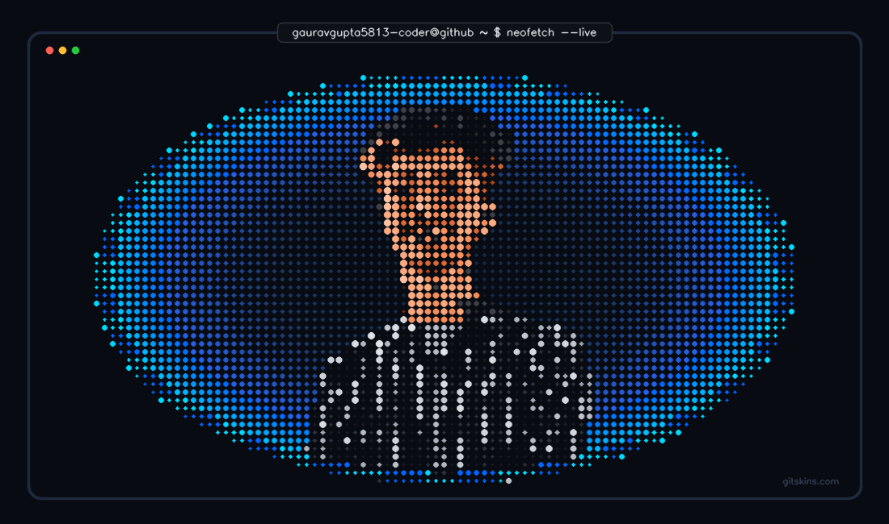

<div align="center">

  <!-- Animated Terminal Typing Header -->
  <a href="https://github.com/gauravgupta5813-coder">
    
  </a>

  <p align="center">
    
  </p>

</div>

```bash
gauravgupta5813-coder@github ~ $ neofetch --live
```

<table align="center" border="0" style="border: none; background: transparent; width: 100%;">
  <tr style="border: none; background: transparent;">
    <!-- Halftone Dot-Matrix Portrait -->
    <td width="55%" align="center" valign="middle" style="border: none; padding: 10px;">
      
    </td>
    <!-- Neofetch System Information -->
    <td width="45%" align="left" valign="middle" style="border: none; padding: 15px;">

```yaml
gauravgupta@iiitn
---------------------------
OS       : Developer Mode
Host     : IIIT Nagpur
Kernel   : CSE Data Science
Uptime   : 2 Years
Shell    : Learning & Building
Language : C++ / Python / Java
Focus    : ML | DL | GenAI | DSA
Editor   : VS Code
Status   : Always Learning
```

<!-- Terminal Color Palette Pills -->
<p align="left">
  <code>● #080B12</code> 
  <code>● #00FF88</code> 
  <code>● #00D9FF</code> 
  <code>● #0066FF</code> 
  <code>● #A855F7</code> 
  <code>● #FF884D</code> 
  <code>● #E5E7EB</code>
</p>

    </td>
  </tr>
</table>

###  01. About Me

```bash
gauravgupta5813-coder@github ~ $ cat about_me.txt
```

> Hey there! I'm **Gaurav Gupta**, a 2nd-year undergraduate pursuing **Computer Science and Engineering (Data Science)** at **Indian Institute of Information Technology, Nagpur**.
>
> I am deeply fascinated by how intelligent systems learn patterns from raw data and transform ideas into reality. My technical journey revolves around building models in **Machine Learning**, diving into **Deep Learning architectures**, and exploring the frontier of **Generative AI**.
>
> At the same time, I believe solid engineering foundations are key to solving hard problems—so I actively hone my problem-solving skills through **Data Structures and Algorithms** and build robust, full-stack projects to bridge research with utility.

###  02. Tech Stack

```bash
gauravgupta5813-coder@github ~ $ list --skills --all
```

**Programming Languages**

<p align="left">
  
  
  
  
  
</p>

**AI, Machine Learning & Data Science**

<p align="left">
  
  
  
  
  
</p>

**Developer Tools & Platforms**

<p align="left">
  
  
  
  
</p>

###  03. Currently Working On

```bash
gauravgupta5813-coder@github ~ $ ps aux | grep 'active-goals'
```

```yaml
[01] Machine Learning and Deep Learning projects.
[02] Generative AI, LLMs and Transformers.
[03] Data Science experiments.
[04] Data Structures and Algorithms practice.
[05] Full-Stack Development.
```

###  04. GitHub Analytics

```bash
gauravgupta5813-coder@github ~ $ fetch --stats --github
```

<p align="center">
  
  
</p>

<p align="center">
  
</p>

<p align="center">
  
</p>

###  05. LeetCode Metrics

```bash
gauravgupta5813-coder@github ~ $ curl -s leetcode.com/u/Gaurav-Gupta123
```

<p align="center">
  <a href="https://leetcode.com/u/Gaurav-Gupta123/" target="_blank">
    
  </a>
</p>

###  06. Connect With Me

```bash
gauravgupta5813-coder@github ~ $ ping -c 4 connection.gaurav
```

<p align="center">
  <a href="https://github.com/gauravgupta5813-coder" target="_blank">
    
  </a>
  <a href="https://leetcode.com/u/Gaurav-Gupta123/" target="_blank">
    
  </a>
  <a href="https://linkedin.com/in/gaurav-gupta-ds" target="_blank">
    
  </a>
  <a href="mailto:gauravgupta.cse.ds@gmail.com">
    
  </a>
</p>

---

```bash
gauravgupta5813-coder@github ~ $ echo "Thanks for stopping by! Let's collaborate and build something impactful."
Thanks for stopping by! Let's collaborate and build something impactful.

[Process completed - Exit Code 0] ⚡
```

<p align="center">
  <sub>Crafted with custom dot-matrix halftone engine • Inspired by Linux Neofetch</sub>
</p>
